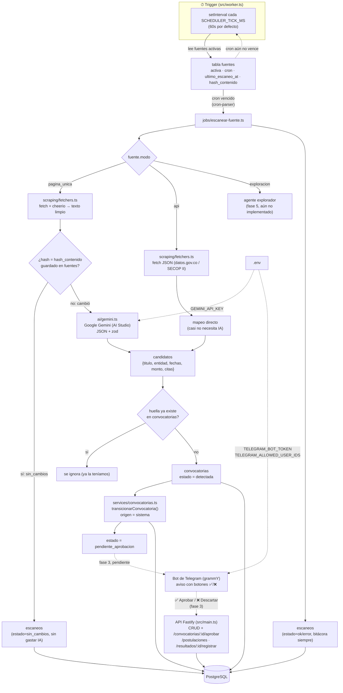

# Lupe · backend

Agentes de búsqueda de convocatorias, integración con Telegram y modelo de
datos para Asisco Up (Manizales). Esta entrega cubre: el **CRUD** del modelo
de datos v2, el **flujo inicial** del ciclo de vida de una convocatoria
(estados + transiciones) y **el trigger que escanea las fuentes** (el
scheduler que lee `fuentes` y dispara el scraping + IA). El bot de Telegram
queda para la fase siguiente.

## Stack

Node.js 22 + TypeScript, Fastify, Prisma 7 (driver adapter `pg`), zod, pino,
`cron-parser` + `cheerio` (scraping), `@google/genai` (Gemini). Ver "Fastify
vs. NestJS" y "Modelo de IA" más abajo.

## Primeros pasos

```bash
npm install
cp .env.example .env     # completa DATABASE_URL, TELEGRAM_BOT_TOKEN, GEMINI_API_KEY
npx prisma generate      # genera el client en generated/prisma
npx prisma migrate dev --name init   # crea las tablas
psql "$DATABASE_URL" -f prisma/views/vw_finanzas_convocatorias.sql  # crea la vista de finanzas

npm run dev       # API Fastify → http://localhost:3000
npm run worker    # trigger de fuentes + tarea de vencimiento (otra terminal)
```

> ⚠️ Este sandbox no tiene salida de red hacia `binaries.prisma.sh`, así que
> no pude ejecutar `prisma generate`/`migrate` aquí. `tsc --noEmit` compila
> limpio salvo los imports a `generated/prisma/client.js` (que aparecen una
> vez corras `prisma generate` localmente). Corre esos comandos en tu
> máquina o en CI antes de `npm run dev` / `npm run worker`.

## Conectar a Supabase

La base de datos vive en Supabase, pero Prisma habla Postgres directo, no la
API/SDK de Supabase — así que solo hace falta **`DATABASE_URL`**:

1. Supabase → tu proyecto → **Project Settings → Database → Connection string**.
2. Copia la variante **"Session pooler"** (puerto 5432, vía Supavisor) y pégala
   en `DATABASE_URL`. Es la recomendada aquí: funciona como Postgres normal
   (soporta prepared statements, que es como consulta `@prisma/adapter-pg`) y
   no necesita salida IPv6, a diferencia de la "Direct connection".
3. `npx prisma migrate dev` y `npm run dev` / `npm run worker` usan esa misma
   `DATABASE_URL` — no hace falta nada más.

> Si en vez del pooler de sesión usas el **"Transaction pooler"** (puerto
> 6543), `prisma migrate` falla porque ese modo no soporta las sesiones que
> las migraciones necesitan. En ese caso agrega una `DIRECT_URL` con la
> conexión directa y, en `prisma/schema.prisma`, `directUrl = env("DIRECT_URL")`
> dentro de `datasource db` (ver [docs de Prisma](https://www.prisma.io/docs/orm/prisma-schema/overview/data-sources)).

Las otras 4 variables que ya tienes (`SUPABASE_URL`, `SUPABASE_PUBLISHABLE_KEY`,
`SUPABASE_SECRET_KEY`, `SUPABASE_JWKS_URL`) son para el SDK/API REST de
Supabase (Storage, Auth), no para la base de datos. Quedan declaradas en
`.env.example`/`config/env.ts` por si más adelante conectas **Supabase
Storage** para los archivos de `documentos_fundacion` o **Supabase Auth**
para un panel web — hoy ningún archivo de `src/` las usa.

## Arquitectura: del trigger de fuentes a Telegram



**Por qué un `setInterval` y no pg-boss todavía:** con dos fuentes y una
revisión diaria, no hace falta una cola separada — un *tick* que lee
Postgres cada minuto y compara el `cron` de cada fuente (con `cron-parser`)
contra `ultimo_escaneo_at` es suficiente y no agrega infraestructura. El
punto de entrada (`jobs/escanear-fuente.ts`) ya queda aislado para que
cambiar el *trigger* por pg-boss más adelante (fase 5) no toque nada más.

## Modelo de IA: Google Gemini (AI Studio)

Gemini es el proveedor por defecto (`IA_PROVIDER=gemini` en `.env`):

- Se activa con una cuenta de Google, sin tarjeta, con nivel gratuito real.
- Los modelos Flash aguantan hasta ~1M tokens de contexto: suficiente para
  leer de un tirón una página larga de SECOP o de la Alcaldía.
- Devuelve JSON estructurado (`responseJsonSchema`), que `src/ai/gemini.ts`
  vuelve a validar con **zod** antes de tocar la base de datos — nunca se
  confía en el modelo a ciegas.
- Con el volumen actual (dos fuentes, revisión diaria) los límites gratuitos
  sobran (de 5 a 15 peticiones/min y entre 20 y 1.500/día según el modelo,
  cifras de abril de 2026 — **confírmalas en Google AI Studio**, cambian seguido).

**Cuidados que ya quedaron en el diseño:**
- *Privacidad*: nunca le pasamos a Gemini los documentos de la fundación
  (RUT, cédulas, certificados) — eso vive en `documentos_fundacion`/Telegram,
  no en el prompt del evaluador. Solo se le manda el texto de páginas
  públicas (SECOP, Alcaldía).
- *Calidad*: `analisis_ia` en `convocatorias` guarda `citaFechaCierre` /
  `citaMonto` (la cita textual que el modelo dice haber usado) con un flag
  `verificado: false` — la verificación carácter-a-carácter contra la página
  queda pendiente (ver § Pendiente); hasta que esté, toda convocatoria pasa
  por aprobación humana igual (`pendiente_aprobacion`).
- *SECOP II*: la fuente en modo `api` (datos.gov.co) casi no gasta IA porque
  ya viene estructurado (`escanearComoApi` en `jobs/escanear-fuente.ts`); la
  cuota de Gemini se gasta solo en páginas de la Alcaldía.

**Plan B si Gemini se queda sin cupo** (`IA_PROVIDER` + su propia API key en
`.env`, no están conectados todavía, solo documentados):

| Proveedor | Límite gratis aprox. | Contexto | Nota |
|---|---|---|---|
| **Groq** | ~30 req/min, 1.000/día | 128K | Rapidísimo; Llama 3.3 70B. Buen plan B. |
| **OpenRouter** | 50 req/día sin saldo | varía | +20 modelos gratis, calidad variable, útil para probar. |
| **Cerebras** | ~1M tokens/día | varía | |
| Cloudflare Workers AI | — | 2K–8K | Contexto muy chico, no sirve para leer páginas enteras. |

## Fastify vs. NestJS

Fastify (no NestJS): el proyecto tiene dos puntos de entrada livianos (API y
worker) que comparten funciones simples — NestJS agregaría DI, módulos y
decoradores pensados para equipos grandes, que aquí serían peso muerto. Ver
el hilo anterior de este README (commits previos) para el detalle completo.

## Estructura

```
src/
├── main.ts                 # arranca la API (Fastify)
├── worker.ts                # arranca el trigger de fuentes + tarea de vencimiento
├── config/env.ts             # variables de entorno validadas con zod
├── db/prisma.ts               # instancia única de Prisma Client
├── ai/gemini.ts                # cliente Gemini + validación zod de la respuesta
├── scraping/fetchers.ts         # fetch + cheerio (HTML) / fetch JSON (api)
├── jobs/
│   ├── scheduler.ts               # EL trigger: tick cada SCHEDULER_TICK_MS
│   └── escanear-fuente.ts          # pipeline de un escaneo (ver diagrama)
├── schemas/                  # validación de entrada (zod) por entidad
├── services/
│   └── convocatorias.ts        # LA máquina de estados: única puerta para
│                                 # cambiar convocatorias.estado (ver abajo)
└── http/
    ├── server.ts                # arma la app Fastify y registra rutas
    ├── crud.ts                   # factory genérico de CRUD
    ├── errors.ts, serialize.ts
    └── routes/                   # un archivo por recurso
```

## Endpoints

CRUD estándar (`GET /recurso`, `GET /recurso/:id`, `POST`, `PATCH /:id`,
`DELETE /:id`, con `?take=&skip=` para paginar):

- `/fuentes`
- `/convocatorias` (POST acepta `estadoInicial: "detectada" | "no_apta"`)
- `/adjudicaciones`
- `/recordatorios`
- `/documentos-fundacion` — carpeta digital de la fundación (RUT, certificados...)
- `/convocatoria-documentos` — qué documento pide cada convocatoria puntual

Solo lectura (las escribe el sistema: worker, agentes):

- `/convocatoria-eventos`, `/escaneos`

### Autorización sin tabla de usuarios

v2 no tiene `usuarios_telegram` ni `chat_messages`: nadie queda registrado
como "quién hizo qué", solo si el cambio vino de `sistema` o de `usuaria`
(`convocatoria_eventos.origen`). La autorización del bot (fase 3) se resuelve
aparte, comparando el `chat_id` de Telegram contra `TELEGRAM_ALLOWED_USER_IDS`
en `.env` (ver `config/env.ts#allowedTelegramUserIds`) — no contra una tabla.

### El flujo inicial: ciclo de vida de una convocatoria

Todo cambio de estado pasa por `services/convocatorias.ts`, que valida la
tabla de "Transiciones permitidas" del documento de diseño y escribe el
evento en `convocatoria_eventos` en la misma transacción:

```
detectada → pendiente_aprobacion → aprobada → en_postulacion → postulada → ganada | no_ganada
                                                                      ↘ no_apta / descartada / vencida (salidas alternas)
```

- `GET /convocatorias/:id/transiciones` — qué estados siguientes son válidos.
- `POST /convocatorias/:id/transiciones` — transición genérica `{ estado, origen?, nota? }`.
- `POST /convocatorias/:id/aprobar` / `/descartar` — atajos de la directora (`origen=usuaria`).
- `GET /convocatorias/:id/eventos` — historial de estado (auditoría).
- `GET|POST /convocatorias/:id/pasos` y `POST .../pasos/:pasoId/completar` —
  paso a paso de la postulación; completar el primer paso con la
  convocatoria en `aprobada` dispara automáticamente `en_postulacion`.
- `GET /convocatorias/:id/documentos` — qué documentos pide, y si ya están listos.
- `POST /postulaciones` — "🎒 Ya radicamos": crea `postulaciones` +
  `resultados` (pendiente) y mueve la convocatoria a `postulada`.
- `POST /resultados/:id/registrar` — "/resultado": registra
  `ganada`/`no_ganada` y mueve la convocatoria al estado final.
- `POST /adjudicaciones` — solo permite adjudicar un resultado `ganada`
  (refleja la FK compuesta `(resultado_id, resultado_estado)` del modelo);
  `montoRecibido` reemplaza a la antigua tabla `desembolsos`.

## Historial del modelo (v1 → v2)

- `fuentes.modo` gana `"api"` (datos abiertos, ej. SECOP II vía datos.gov.co).
- `convocatorias` gana `numero_proceso`; pierde `documentos_requeridos`
  (ahora es relacional: `convocatoria_documentos` + `documentos_fundacion`).
- Se quitan `usuarios_telegram`, `chat_messages` y `desembolsos`. Los FK de
  "quién lo hizo" (`aprobada_por`, `radicada_por`, `registrado_por`,
  `completado_por`) se reemplazan por `convocatoria_eventos.origen`
  (`sistema` | `usuaria`). `adjudicaciones.monto_recibido` reemplaza a
  `desembolsos` para calcular `saldo_por_recibir` en la vista de finanzas.

## Pendiente para las siguientes fases

- Verificación de citas carácter-a-carácter contra la página (hoy se guarda
  la cita que trae el modelo, con `verificado: false`).
- Elegibilidad automática contra `config/perfil-fundacion.ts` (hoy toda
  convocatoria detectada pasa a `pendiente_aprobacion`; la directora filtra).
- Bot de Telegram (grammY) sobre este mismo CRUD/flujo, con el aviso con
  botones ✅/❌ que dispara `/convocatorias/:id/aprobar|descartar`.
- Agente explorador multi-página (modo `exploracion`, hoy lanza "no implementado").
- Cambiar el `setInterval` del worker por pg-boss si el número de fuentes crece.
