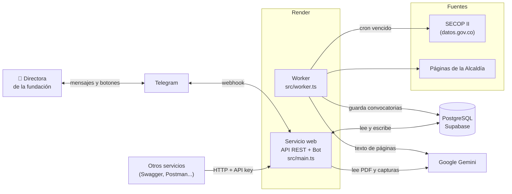
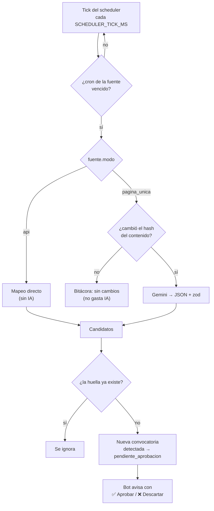

# Lupe 🔍

**Lupe es un bot de Telegram que busca convocatorias de financiación y contratos públicos (SECOP II, Alcaldía de Manizales) para la fundación Asisco Up, las resume con IA y acompaña a la fundación desde que decide postularse hasta que registra el resultado.**

Detrás del bot hay un backend con una API REST (documentada con Swagger), un worker que escanea las fuentes automáticamente y una base de datos Postgres.

| | |
|---|---|
| 🤖 Bot de Telegram | [@lupe_asisco_bot](https://t.me/lupe_asisco_bot) |
| 🌐 API en producción | https://lupe-d5f2.onrender.com |
| 📖 Documentación Swagger | https://lupe-d5f2.onrender.com/api-docs |
| 📄 Especificación OpenAPI (JSON) | https://lupe-d5f2.onrender.com/api-docs.json |
| ❤️ Estado del servidor | https://lupe-d5f2.onrender.com/health |

> El servicio gratuito de Render se duerme tras un rato sin uso: la primera petición puede tardar cerca de un minuto.

## Contenido

1. [Qué hace Lupe](#qué-hace-lupe)
2. [Cómo probarlo](#cómo-probarlo)
3. [Arquitectura](#arquitectura)
4. [Ciclo de vida de una convocatoria](#ciclo-de-vida-de-una-convocatoria)
5. [API REST](#api-rest)
6. [Integración con otros servicios](#integración-con-otros-servicios)
7. [Ejecutar en local](#ejecutar-en-local)
8. [Variables de entorno](#variables-de-entorno)
9. [Estructura del código](#estructura-del-código)
10. [Decisiones técnicas](#decisiones-técnicas)
11. [Pendiente](#pendiente)

## Qué hace Lupe

1. **Busca.** Un worker revisa las fuentes según su programación (cron): SECOP II vía datos abiertos (`datos.gov.co`) y páginas de la Alcaldía.
2. **Entiende.** Gemini extrae título, entidad, fechas y monto de las páginas; los datos se validan con zod antes de guardarse. SECOP casi no gasta IA porque ya viene estructurado.
3. **Avisa.** Las convocatorias nuevas llegan a Telegram con botones **✅ Aprobar / ❌ Descartar**, y cada mañana se envía un resumen.
4. **Prepara la postulación.** Al aprobar una convocatoria, la directora manda el pliego en PDF (y una captura del cronograma): el bot lee los documentos y arma el paso a paso, la fecha de cierre y la lista de documentos exigidos.
5. **Recibe convocatorias de otras fuentes.** Las que le llegan a la directora por correo o WhatsApp (fundaciones empresariales, ICBF, cooperación) las agrega mandándole al bot el PDF, una captura o el enlace: Lupe identifica la convocatoria y la deja en pendientes con su paso a paso.
6. **Redacta borradores.** Carta de presentación y propuesta técnica en Word, a partir de lo que pide la convocatoria (sobre todo sus criterios de evaluación) y del perfil de la fundación. Lo que no sabe no lo inventa: lo deja como [campo] resaltado en amarillo, y lo que la convocatoria exige queda como [confirmar: …].
7. **Controla los documentos de la fundación.** RUT, cámara de comercio, cédulas, etc., con su estado (✅ vigente, ⚠️ por vencer, ❌ vencido) y cruzados con lo que pide cada convocatoria.
8. **Da seguimiento.** `/aprobadas` lista las convocatorias en preparación, de la que cierra primero a la última, y cada una abre un checklist con su paso a paso y sus documentos para ir marcando lo hecho (el primer paso la pasa a "en postulación"). Por API también se registran la radicación, el resultado (ganada / no ganada) y la adjudicación con el monto recibido.

## Cómo probarlo

### Desde Telegram

Abrir [@lupe_asisco_bot](https://t.me/lupe_asisco_bot) y escribir `/start`.

| Comando | Qué hace |
|---|---|
| `/pendientes` | Convocatorias esperando decisión, con botones ✅ Aprobar / ❌ Descartar |
| `/convocatoria <id>` | Muestra una convocatoria puntual |
| `/nueva` | Agregar una convocatoria que llegó por otro lado: enviar su PDF, una captura o el enlace |
| `/aprobadas` | Convocatorias aprobadas o en postulación con su avance (🟢 lista · 🟡 en marcha · ⚪ sin empezar · 🔴 cierra en ≤ 3 días). Cada una abre su checklist: tocar un paso o un documento lo marca o desmarca. También con el botón **📋 Checklist** |
| `/borrador` | Respondiendo a la tarjeta de una convocatoria: carta de presentación o propuesta técnica en Word (también con el botón **📝 Borradores**). Los datos institucionales (NIT, representante legal, dirección…) se llenan una vez en `src/config/perfil-fundacion.ts` → `DATOS_FUNDACION` |
| `/documentos` | Carpeta de la fundación: ver, subir, reemplazar, editar o eliminar documentos |
| `/avisos` | Activa o desactiva el resumen diario |
| `/resumen` | Convocatorias nuevas de las últimas 24 horas |
| `/ayuda` | Lista de comandos |

Para ver el análisis de documentos: mantener presionada la tarjeta de una convocatoria → *Responder* → adjuntar el PDF del pliego.

Para agregar una convocatoria nueva: `/nueva` y enviar el PDF, la captura o el enlace (también sirve mandarlo sin comando: el bot pregunta si es nueva). Si ya estaba en Lupe, no se duplica. Quedan bajo la fuente desactivada *"Agregadas desde Telegram"*, que el escaneo no recorre y la re-evaluación por perfil no toca. Los enlaces solo pueden ser direcciones públicas (http/https); los de Google Drive se convierten en descarga directa.

**Acceso:** solo los IDs de Telegram listados en `TELEGRAM_ALLOWED_USER_IDS` pueden usar el bot; si la lista está vacía, queda abierto a cualquiera. Quien no tenga permiso recibe un mensaje con su propio ID para pedir acceso.

**Errores controlados:** un id mal escrito en `/convocatoria`, un usuario no autorizado, un PDF ilegible o el presupuesto diario de IA agotado devuelven un mensaje claro, no un fallo.

### Desde Swagger (navegador)

1. Abrir https://lupe-d5f2.onrender.com/api-docs (no requiere clave).
2. Pulsar **Authorize**, pegar la API key en `apiKey` y confirmar.
3. Abrir un endpoint → **Try it out** → **Execute**.

La API key es el valor de la variable `API_KEY` del servicio; quien administra el proyecto la entrega.

Recorrido sugerido:

| Petición | Resultado esperado |
|---|---|
| `GET /health` (sin clave) | `200` |
| `GET /convocatorias` antes de autorizar | `401` |
| `GET /convocatorias` autorizado | `200` con `{ items, total, take, skip }` |
| `POST /convocatorias` con `{}` | `400` con el detalle por campo |
| `GET /convocatorias/{id}` con un id inexistente | `404` |

También funciona con Postman (*Import → Link* con la URL del JSON) o con `curl`:

```bash
curl https://lupe-d5f2.onrender.com/health
curl -H "x-api-key: <clave>" "https://lupe-d5f2.onrender.com/convocatorias?estado=pendiente_aprobacion&take=5"
```

## Arquitectura



**Dos procesos, una base de datos.** El **worker** escanea y guarda; el **servicio web** sirve la API REST y el bot (por webhook en producción, por long polling en local). Solo el servicio web habla con Telegram.

Cómo trabaja un escaneo (`src/jobs/escanear-fuente.ts`):



## Ciclo de vida de una convocatoria

Todo cambio de estado pasa por `src/services/convocatorias.ts`, que valida las transiciones permitidas y guarda el evento en `convocatoria_eventos` (auditoría) dentro de la misma transacción. Una transición no permitida responde `409`.

```
detectada → pendiente_aprobacion → aprobada → en_postulacion → postulada → ganada | no_ganada
                                                                      ↘ no_apta / descartada / vencida (salidas alternas)
```

Cada evento queda marcado con su origen: `sistema` (worker) o `usuaria` (decisión humana en el bot).

## API REST

La referencia completa e interactiva está en [Swagger](https://lupe-d5f2.onrender.com/api-docs). Resumen:

**Autenticación.** Toda petición, salvo `/health`, `/api-docs*` y `/telegram/webhook`, lleva la clave en `x-api-key: <clave>` o `Authorization: Bearer <clave>` (son equivalentes). Sin ella: `401`. `API_KEY` es obligatoria en producción; en desarrollo, si falta, la API queda abierta y lo avisa en el log. El webhook de Telegram se protege aparte con `TELEGRAM_WEBHOOK_SECRET`.

**Formato de error.** Siempre `{ "error": "...", "message": "...", "details": ... }`.

| Código | Cuándo |
|---|---|
| `200` / `201` / `204` | Éxito (consulta / creación / borrado) |
| `400` | Validación fallida; `details.fieldErrors` indica qué campo |
| `401` | Falta la API key o es inválida |
| `404` | El id no existe |
| `409` | Transición o estado no permitido (p. ej. adjudicar un resultado que no es `ganada`) |
| `500` | Error interno |

**Recursos CRUD** (`GET /x`, `GET /x/{id}`, `POST /x`, `PATCH /x/{id}`, `DELETE /x/{id}`; los listados aceptan `?take=&skip=`):
`/fuentes`, `/convocatorias` (filtros `estado`, `fuenteId`), `/postulaciones`, `/adjudicaciones`, `/recordatorios`, `/documentos-fundacion`, `/convocatoria-documentos`.

**Solo lectura** (los escribe el sistema): `/convocatoria-eventos`, `/escaneos`.

**Acciones del flujo:**

| Endpoint | Qué hace |
|---|---|
| `GET /convocatorias/{id}/transiciones` | Estados siguientes válidos |
| `POST /convocatorias/{id}/transiciones` | Transición genérica `{ estado, origen?, nota? }` |
| `POST /convocatorias/{id}/aprobar` · `/descartar` | Decisión de la directora (`origen = usuaria`) |
| `GET /convocatorias/{id}/eventos` | Historial de estados |
| `GET·POST /convocatorias/{id}/pasos` · `POST …/pasos/{pasoId}/completar` | Paso a paso de la postulación; completar el primero dispara `en_postulacion` |
| `GET /convocatorias/{id}/documentos` | Documentos exigidos y si ya están listos |
| `POST /postulaciones` | "Ya radicamos": crea la postulación y un resultado pendiente, y pasa la convocatoria a `postulada` |
| `POST /resultados/{id}/registrar` | Registra `ganada` / `no_ganada` |
| `POST /adjudicaciones` | Solo para resultados `ganada`; `montoRecibido` lleva el dinero recibido |

## Integración con otros servicios

- **Contrato:** la especificación OpenAPI 3 en `/api-docs.json` (también `npm run docs:export` → `openapi.json`). Se puede importar en Postman o generar un cliente.
- **Acceso:** HTTPS + API key. Cada servicio consumidor debería tener su propia clave si se quiere poder revocarla por separado (hoy hay una sola `API_KEY`).
- **Datos compartidos:** worker, bot y API leen y escriben la misma base Postgres (vía Prisma); un cambio hecho por cualquiera es visible para los demás.
- **Lectura típica:** `GET /convocatorias?estado=pendiente_aprobacion`. **Escritura típica:** `POST /convocatorias/{id}/aprobar`.

## Ejecutar en local

Requisitos: Node.js 22, una base Postgres (se usa Supabase) y, para la IA, una clave de [Google AI Studio](https://aistudio.google.com/apikey).

```bash
npm install
cp .env.example .env             # completa DATABASE_URL, API_KEY, TELEGRAM_BOT_TOKEN, GEMINI_API_KEY
npx prisma generate
npx prisma migrate dev           # crea las tablas
psql "$DATABASE_URL" -f prisma/views/vw_finanzas_convocatorias.sql   # vista de finanzas

npm run dev       # API + bot → http://localhost:3000 (Swagger en /api-docs)
npm run worker    # scheduler de fuentes (otra terminal)
npm test          # pruebas (vitest)
```

Sin `PUBLIC_URL` y `TELEGRAM_WEBHOOK_SECRET` el bot usa long polling; con ambos, webhook. No corras dos instancias con el mismo token en modo polling: se pisan.

**Producción (Render):** el servicio web ejecuta `node dist/main.js` (API + bot) y el worker `node dist/worker.js`. El `Dockerfile` construye la imagen; las migraciones se aplican con `npm run db:deploy`.

<details>
<summary><b>Conectar a Supabase (detalle)</b></summary>

Prisma habla Postgres directo, no la API/SDK de Supabase, así que solo hace falta `DATABASE_URL`: Supabase → *Project Settings → Database → Connection string* → variante **Session pooler** (puerto 5432). Es compatible con redes solo IPv4 y soporta prepared statements. Evita el *Transaction pooler* (6543): rompe `prisma migrate` salvo que agregues `DIRECT_URL` y `directUrl` en `datasource db`.

Las variables `SUPABASE_*` están reservadas para Storage o Auth futuros; hoy nada en `src/` las usa.
</details>

## Variables de entorno

Plantilla completa con comentarios en [`.env.example`](.env.example).

| Variable | Para qué |
|---|---|
| `DATABASE_URL` | Conexión Postgres (obligatoria) |
| `API_KEY` | Clave de la API REST, mínimo 32 caracteres (obligatoria en producción) |
| `TELEGRAM_BOT_TOKEN` | Token del bot; sin él, el bot no arranca |
| `TELEGRAM_WEBHOOK_SECRET`, `PUBLIC_URL` | Activan el modo webhook |
| `TELEGRAM_ALLOWED_USER_IDS` | IDs autorizados, separados por coma (vacío = abierto) |
| `TELEGRAM_AVISOS_CHAT_IDS`, `AVISOS_CRON` | Quién recibe el resumen diario y a qué hora (por defecto 7:30 a. m.) |
| `GEMINI_API_KEY`, `MODELO_EVALUADOR`, `MODELO_EXPLORADOR` | IA |
| `MAX_TOKENS_DIA` | Tope diario de tokens de IA |
| `SCHEDULER_TICK_MS` | Cada cuánto el worker revisa qué fuentes tocan |

## Estructura del código

```
src/
├── main.ts · worker.ts        # puntos de entrada: API + bot / scheduler
├── config/env.ts              # variables de entorno validadas con zod
├── http/                      # Fastify: server, auth por API key, CRUD genérico, rutas por recurso
├── docs/swagger.ts            # especificación OpenAPI 3
├── bot/                       # bot de Telegram (grammY): comandos, avisos, carpeta, documentos
├── jobs/                      # scheduler y pipeline de escaneo de fuentes
├── scraping/                  # fetch + cheerio (HTML) y SECOP II (API)
├── ai/                        # Gemini: evaluador, explorador de PDF, presupuesto, reintentos
├── explorador/                # aplica al modelo lo que se leyó de los pliegos
├── elegibilidad/              # reglas de elegibilidad frente al perfil de la fundación
├── services/                  # máquina de estados y sincronización de documentos
├── schemas/                   # validación de entrada (zod) por entidad
└── db/prisma.ts               # Prisma Client
prisma/                        # esquema, migraciones y vista de finanzas
test/                          # pruebas con vitest
```

## Decisiones técnicas

- **Stack:** Node.js 22, TypeScript, Fastify, Prisma 7 (adapter `pg`), zod, grammY, Gemini.
- **Fastify y no NestJS:** son dos puntos de entrada livianos que comparten funciones simples; NestJS agregaría módulos e inyección de dependencias que aquí serían peso muerto.
- **Un `setInterval` y no una cola (pg-boss):** con pocas fuentes y revisión diaria basta un tick que compara el `cron` de cada fuente con `ultimo_escaneo_at`. El pipeline está aislado para cambiar el trigger sin tocar nada más.
- **Gemini:** nivel gratuito real y contexto largo (lee un pliego completo). La respuesta siempre se valida con zod; nunca se confía en el modelo a ciegas. Plan B documentado: Groq, OpenRouter, Cerebras (`IA_PROVIDER`).
- **Privacidad:** los documentos de la fundación (RUT, cédulas…) nunca se envían al evaluador de convocatorias; viven en Telegram (se guarda su `file_id`) y solo el explorador lee lo que la directora envía a propósito.
- **Humano en el ciclo:** toda convocatoria pasa por aprobación de la directora; la IA propone, no decide.
- **Sin tabla de usuarios:** la autorización del bot compara el ID de Telegram con `TELEGRAM_ALLOWED_USER_IDS`, y el historial solo distingue `sistema` de `usuaria`.
- **SECOP y reCAPTCHA:** la página de detalle de un proceso en SECOP II está protegida, así que los pliegos los envía la directora al bot.

